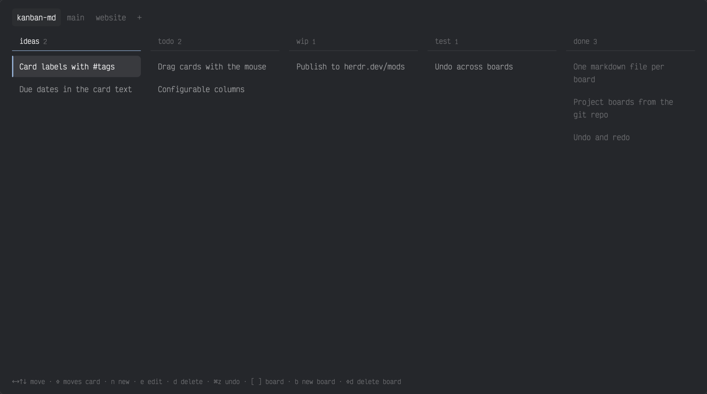

# kanban-md

Plain-text kanban boards for [Herdr](https://herdr.dev). Every board is a markdown file, so you, your editor and your agents all work on the same thing.



## Install

Ask an agent in Herdr to add `github.com/duartecaldascardoso/kanban-md`, or by hand:

```sh
git clone https://github.com/duartecaldascardoso/kanban-md
cp -R kanban-md/mods/kanban-md ~/.config/herdr-app/mods/
```

Then add `"cmd-shift-k": "mod.open:kanban-md"` to the `global` section of `~/.config/herdr-app/keys.json`.

## Use

`⌘⇧K` opens the board. Five columns: ideas, todo, wip, test, done.

| Key | Action |
| --- | --- |
| `← → ↑ ↓` or `h l k j` | Move between cards and columns |
| `⇧` + move | Move the card |
| `n` | New card |
| `e`, `enter` or double-click | Edit card (empty text deletes it) |
| `d` | Delete card |
| `⌘Z` / `⌘⇧Z` | Undo / redo |
| `[` `]` or `tab` | Switch board |
| `b` | New board |
| `p` | New board for the current project |
| `⇧D` | Delete board |
| `esc` | Close |

## Files

Boards live in `~/kanban/<board>.md`:

```markdown
# website

## Todo
- Write the launch post

## Done
- Pick a domain
```

Edits made elsewhere show up within a few seconds. Lines that are not a column heading or a `- ` card are dropped on the next save. Deleted boards move to `~/kanban/.trash/`.

A board named after a git repository is that project's board: it opens first when the focused terminal is inside that repository.

### Agents

Tell your agents where the boards are, for example in their `AGENTS.md`:

```markdown
My kanban boards are markdown files in ~/kanban/<board>.md, named after the project's git repository.
Columns are `## Ideas`, `## Todo`, `## WIP`, `## Test`, `## Done`; cards are `- ` lines.
```

## Development

```sh
npm test        # board logic
herdr-app check mods/kanban-md
```

## License

[MIT](LICENSE)
