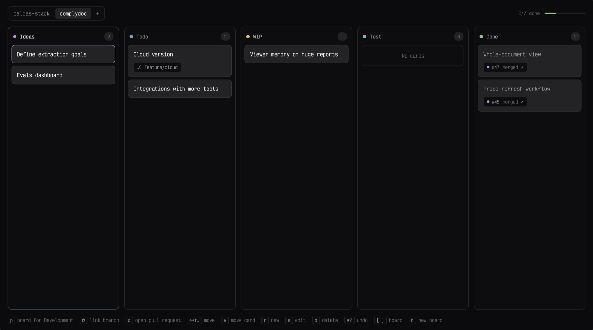

# kanban-md

A keyboard-driven kanban board that opens over the window with `cmd-shift-k`. Each board is a markdown file in `~/kanban/`, with five columns (ideas, todo, wip, test, done) and one line of text per card. A board named after the focused terminal's git repository opens first.

## What you see

A modal dialog, 92% of the window wide and 82% tall, on the theme's `canvas`, in the terminal font (`settings().font_family`), text 13px, 18px side padding. Every colour comes from `theme()`, so the board follows the active theme.

- **Top row:** the boards as a segmented control: a 3px-padded `background` group with a `border`, one 26px tab per board file sorted by name, the open one on `raised` with `foreground` text, the rest `muted`. The current project's board has a 5px `accent` dot after its name. A `+` ends the group; while a board is being named, a 160px input takes its place. On the right, `done/total done` in 11.5px `dim` and a 96×4px bar filled `ansi2` by the share in done.
- **Columns:** five equal panels, 12px apart, rounded 10px, `background` with a 1px `border` (the cursor's column: `accent` at 40%). A header: an 8px dot in the column's colour (ideas `ansi5`, todo `ansi4`, wip `ansi3`, test `ansi6`, done `ansi2`), the name ("Ideas", "WIP"…) in 12.5px semibold (`foreground` for the cursor's column, `muted` otherwise), and the count in an 11px `raised` pill. An empty column shows a bordered "No cards" box ("n to add a card" when the cursor is there). Columns scroll on their own.
- **Cards:** 6px apart, 12×10px padding, rounded 8px, `raised` with a 1px `border` (`input` on hover); the selected card is `selected` with an `accent` border. The text wraps; cards in done are `muted`. A link sits on its own line below as a chip (see Links). A card being edited is replaced by a 36px input with an `accent` border.
- **Hint line** (bottom, 11.5px `dim`): keys as keycaps (18px, `background`, 1px `border`) each followed by what it does: the selected card's link actions first, then move, move card, new, edit, delete, undo, board, new board. A linked card's pull request state comes first in words (`#42 open · checks passing · approved`). Questions replace it: `Delete board "<name>"?` in `blocked`, `Push <branch> and open a pull request "<title>"?` in `accent`, each followed by `y` and `any key` caps.

## How it behaves

- Arrows or `hjkl` move the cursor; `1`–`5` jump to a column. With shift they move the card: left/right to the end of the neighbouring column, up/down swapping with its neighbour. The cursor follows the card.
- `n`/`a` add a card at the end of the column; `e`, `enter` or a double-click edits it; enter saves, esc cancels, saving empty text deletes it. `d`/`x`/`backspace` delete. A single click selects a card or column.
- `cmd-z` undoes and `cmd-shift-z` redoes card changes, per board, up to 200 steps, for as long as the dialog is open.
- `[`/`]` or `tab`/`shift-tab` cycle boards; clicking a tab opens it. `b` or `+` names a new board (`/`, `\` and `:` become `-`, leading dots are dropped). `p` creates and opens the project board. `shift-d` asks, then moves the board file to `~/kanban/.trash/<name>-<timestamp>.md`.
- `esc` closes the dialog. The last opened board is remembered in `localStorage`.
- **Links.** A card holding `#42` (or a GitHub pull request URL) is linked to that pull request; `@feature/x` links a branch. The link stays in the card's text; the board shows the text without it (when the link ends it) and the link as a chip on a line below (`#42`, or `⎇ feature/x`): `background`, 1px `border`, 11px. `g` opens the selected card's link in the `snappy-diff` mod as a dialog (`{ repo, pr }` or `{ repo, head }`). `@` links the selected card to the focused repository's current branch: its pull request number from `gh pr view`, else `@<branch>`, replacing an existing link (undoable). The hint line offers `g` open diff, or `@` link branch and `o` open pull request, for the selected card.
- **Pull request state.** For every `#N` on the open board, `gh pr view N --json state,isDraft,reviewDecision,statusCheckRollup` runs in the board's repository when the board opens and every 60 seconds. The chip then reads: a 6px dot (`ansi2` open, `dim` draft, `ansi5` merged, `ansi1` closed), `#N`, the checks (`✓` `ansi2` passing, `✗` `ansi1` failing, `•` `ansi3` pending) and the review (`approved` `ansi2`, `changes` `ansi1`). The hint line reads it out: `#42 open · checks passing · approved`. Cards follow their pull request: merged moves to done, open (not draft) moves from ideas, todo or wip to test; one undo step, and a toast lists the moves.
- `o` opens a pull request from a card: the card's branch, or the repository's current branch (never main or master). The hint line asks `Push <branch> and open a pull request "<title>"? y to confirm`; then `git push -u origin <branch>` and `gh pr create --head <branch> --title <card text>`, and the card's link becomes `#N`.
- A link is hidden from the card's text only when it ends it; inside a sentence it stays.
- **Start work.** `s` on a card asks `Start <agent> on <branch> in a new worktree?` (the agent is the first installed one from `knownAgents()`, Herdr's most picked first). The branch is the card's own link, its pull request's head, or `feature/<card text as a slug>`. An existing checkout of the branch is reused (`git worktree list --porcelain`); otherwise `git worktree add -b <branch> ~/.herdr/worktrees/<repo>/<branch, slashes as dashes> <origin/HEAD or HEAD>`, where Herdr's worktree mod puts them. Then `space.new { name, folder, argv: agent.run, task: card text }`, and the card gains `@<branch>` and moves to wip (one undo step).
- **Agents on cards.** Herdr's `agents()` joined with `panes()` by pane gives each branch's agent (the most urgent when several: blocked, done, working, idle). A card whose branch has one shows a second chip: a 6px dot in the theme's status colour (`working` pulses its opacity), and `working`, `blocked`, `ready` (done) or `idle`. Every 2 seconds while the board is open, an agent that went from working to done or idle on a card's branch posts `<card> is ready for review`, whose action opens snappy-diff on the card in a tab.
- Each project board remembers its repository folder in `~/kanban/.repos.json` (board name → folder), so a board's links open from anywhere once it has been opened inside its project. A board without one looks for a git repository named like it inside or next to the current project, and remembers it.
- Every change writes the board file at once. Every 3 seconds (not while typing) it re-reads the folder and the open board, so edits from an editor or an agent appear. Writes pass the last-read text as `expected`; if the file changed meanwhile, the write is dropped and the file on disk is shown.

## Built from

- `mods/kanban-md/mod.json`: `place: "none"`, `focusable: true`, overlay `{ kind: "dialog", modal: true, width: 0.92, height: 0.82 }`. `keys.json` binds `cmd-shift-k` to `mod.open:kanban-md`.
- `mods/kanban-md/work.js`: pure functions for starting work and following agents: `branchFor`, `worktreePath`, `cardBranch`, `agentsByBranch`, `finished`, `checkoutOf`.
- `bin/kanban`: a Node command over `board.js` for terminals and agents (`show`, `boards`, `add`, `move`, `done`, `edit`, `link`, `rm`; `-b <board>`, else the current repository's board, else main; `KANBAN_DIR` overrides `~/kanban`). Cards are found by their number in `show` or a unique part of their text; writes go through a temporary file and a rename.
- `mods/kanban-md/board.js`: pure functions, no Herdr imports. `parse(text)` reads `## <column>` headings (case-insensitive) and `- `/`* ` cards, ignoring everything else; `serialize(title, lanes)` writes `# <title>` and all five sections; `addCard`, `editCard`, `removeCard`, `shiftCard`, `reorderCard` return `{ lanes, col, row }` or `null` and never mutate their input; `boardName` cleans a typed name; `links.js` turns gh's JSON into `{ state, checks, review }`, picks the column a card belongs in, and reads `gh pr create`'s URL; `cardLink(text)` returns `{ pr, token }`, `{ branch, token }` or `null` and `withoutLink` drops the token. Tested with `node --test`.
- `mods/kanban-md/main.js`: the view. Uses `exec` (`mkdir -p`, `ls`, `mv`, `git -C <cwd> rev-parse --show-toplevel`), `readTextFile`, `writeTextFile`, `focused().cwd`, `home()`, `settings()`, `theme()`, `props().overlay`, `openOverlay` (snappy-diff), `notify` and `closeOverlay`; `gh pr view` for `@`. Keys go through one `KEYS` table to named actions. Text input is one `InputState` shared by every edit.

## Watch out

- The dialog's keys only work while its own focus handle has focus: focus it in `init` and again 300ms later, and after every edit ends.
- While the input is focused, the view must ignore every key except `esc`, or typing triggers board actions.
- Runs programs (`ls`, `mkdir`, `mv`, `git`) and reads and writes `~/kanban/` outside the mod's folder. macOS and Linux only.
- Lines that are not headings or cards, and cards under unknown headings, are lost on the next save.
- The project is the git top-level folder's name; a terminal in the home folder has no project.

## Done when

- `herdr-app check mods/kanban-md` passes and `npm test` passes.
- `cmd-shift-k` opens the dialog on `~/kanban/main.md`, creating `~/kanban/` if missing; `esc` closes it.
- Adding, editing, moving and deleting a card changes `~/kanban/<board>.md` to match, and `cmd-z` restores the previous file.
- A line added to the file in an editor appears on the board within 3 seconds.
- In a terminal inside a git repository with no board, the hint offers `p`, and `p` creates `~/kanban/<repo>.md` and opens it.
- `shift-d` then `y` moves the open board to `~/kanban/.trash/`.
- With snappy-diff installed, `g` on a card holding `#<n>` opens that pull request's diff; esc returns to the board.
