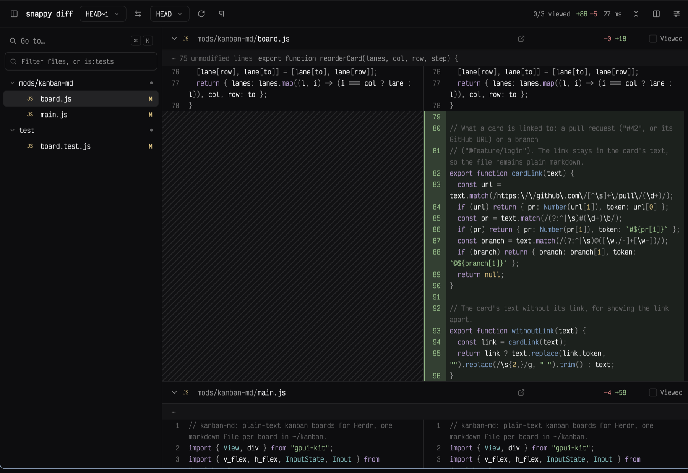

# snappy-diff

A native diff viewer that opens over the window with `cmd-shift-g` and reviews a branch like a pull request: a file tree on the left, every changed file in one scrolling split view, syntax and word-level highlights, viewed marks, and line comments that copy out as a prompt for an agent. A port of the browser app [snappy-diff](https://github.com/duartecaldascardoso/snappy-diff).

## What you see

A modal dialog, 96% of the window wide and 92% tall, on the theme's `background`. UI text 13px in the UI font; code 12.5px in the terminal font (`settings().font_family`), 20px lines.

- **Toolbar** (48px, bottom border): sidebar toggle, "snappy diff" in 14px semibold, then the base picker, a swap button, the head picker ("Working tree" for uncommitted changes, "No commits yet" as the base of a repository without commits), a commit picker ("All N commits") when the range has more than one, reload, and a pilcrow toggle for ignoring whitespace. A pull request under review shows `#N title` beside them. On the right: `viewed/total viewed`, `+added` in `ansi2` and `−removed` in `ansi1`, the load time in ms, **Send to agent (n)** with copy and clear buttons once there are comments, collapse/expand all, split/unified, and settings. Pickers are 28px bordered buttons with a chevron that drop a 300px (commit: 420px) list with a filter field, a check on the current value, and arrow/enter navigation.
- **Sidebar** (288px, right border, toggled with `cmd-b`): a "Go to…" row with `⌘ K` keycaps, a filter field ("Filter files, or is:tests") with a `shown/total` count, then the file tree: folders first, single-child folders folded into one row (`src/lib`), chevrons, 28px rows indented 14px per level. Files show a two-letter type badge (`TS` in `ansi4`, `JS` in `ansi3`, `{}`, `M↓`, `PY`…), the name (`dim` once viewed) and a status letter: `A` `ansi2`, `M` `ansi3`, `D` `ansi1`, `R` `muted`. Folders end in a small dot. The file at the top of the diff is highlighted `selected`.
- **Diff** (the rest): one virtual list of every file. Each file starts with a 40px header: chevron, badge, the folder in `muted` and the name, `generated`/`large`/`changed since viewed` tags, then fixed-width parts from the right: a **Viewed** checkbox (92px), `−del +add` (120px), a comment count (44px), and an open-in-editor icon (32px). Collapsed files show only the header. Separators (28px, faint background) read `⋯ N unmodified lines` and the hunk's function context; a file changed from line 1 has none before its first change.
- **Lines**, split by default: old on the left, new on the right, 1px divider. Each side has a right-aligned line number gutter and the code wrapped at word boundaries to the column's width in characters. Added lines have a translucent `ansi2` background and a 2px `ansi2` bar on the gutter; removed lines the same in `ansi1`; changed words within a paired line a stronger tint, rounded 2px. The side with no line is hatched with faint diagonal stripes. Unified mode shows both line numbers and a `+`/`-` column instead. Syntax: keywords `ansi5`, strings `ansi2`, numbers and constants `ansi3`, calls and keys `ansi4`, types `ansi6`, comments `dim`, punctuation `muted`.
- **Pinned header:** once a file's header scrolls away, a copy pins to the top of the diff with a shadow, until the next file's header arrives.
- **Comments** sit under the last line they cover: a card with `Line N` (or `Lines A–B`), Edit and Delete, and the text. The comment being written is a card with an input, `↵ to save, esc to cancel`, Cancel and a solid Comment button, and the lines it covers are tinted `accent`.
- **Go to** (`cmd-k`) and **search** (`cmd-f`): a 600px panel 80px from the top over a dimmed view, with a search field and up to 120 results: files (fuzzy), commits and actions, or for search, every diff line containing the text as `path:line`.

## How it behaves

- **What it shows first:** the focused terminal's repository (or `props().repo`). The base is `origin/HEAD`'s branch, else `main`, else `master`; with no commits, git's empty tree. With uncommitted work the head is the working tree, compared against where it forked from the base (`git diff --merge-base`), with untracked files as new files; otherwise the current branch as `base...head`. After the first diff shows, `gh pr view` looks for the branch's pull request; if it has one, its base replaces the default. Props `{ repo, base, head }` or `{ repo, pr }` open something specific; a pull request is fetched to `origin/pr/<n>` first.
- **Live:** the working tree is diffed again every 2 seconds; unchanged files keep their parsed rows, so only what changed redraws.
- **Big files:** files changing more than 20,000 lines (by `--numstat`) are left out of the patch and listed as "Too large to show"; binary files say so. Generated files (lockfiles, minified bundles, snapshots) and files over 2,000 changed lines start collapsed.
- **Keys:** `j`/`k` next and previous file (within the sidebar filter), `n` the next file not yet viewed, `v` toggles viewed and moves on, `x` collapses the current file, `o` opens it in the editor at its first change (`zed://file…`, `vscode://`, `cursor://`), `/` focuses the filter (enter jumps to the first match, esc clears), `cmd-b`, `cmd-k`, `cmd-f`, `?` settings, esc closes whatever is open, else the dialog.
- **Viewed** files collapse. The mark stores the file's blob id, so it clears itself when the file changes, which the header then says.
- **Comments:** clicking a line number starts one on that line, shift-click extends from the last one. Enter saves; the comment keeps the code it was on and is hidden as outdated once that code leaves the diff. **Send to agent** writes a numbered prompt (`path:line`, the code in a fenced block, the comment) into the agent working on the branch: Herdr's `agents()` joined with `panes()` by pane, keeping those whose folder is inside the repository or whose branch is the one under review, branch matches first, then the most recent. One is sent to directly with `hc send`; several open a picker. The copy button puts the same prompt on the clipboard. When a reload or the live refresh hides comments because their code changed, a toast says `N comments addressed`.
- Viewed marks and comments are saved per repository and range in `~/.config/herdr-app/data/snappy-diff/`, with the preferences (split or unified, sidebar, editor).

## Built from

- `mods/snappy-diff/mod.json`: `place: "none"`, `focusable: true`, overlay `{ kind: "dialog", modal: true, width: 0.96, height: 0.92 }`. `keys.json` binds `cmd-shift-g` to `mod.open:snappy-diff`.
- Pure modules, tested with `node --test`: `patch.js` parses `git diff` output (files, renames, binaries, quoted paths, hunks bounded by their counts, signatures from blob ids) and writes untracked files as a patch; `words.js` finds changed words by a token LCS, giving up past 40,000 token pairs or under 25% in common; `syntax.js` is a small scanner for C-like languages, Python, shell, Ruby, YAML, TOML, JSON, CSS, SQL, HTML and Markdown that carries block comments and multi-line strings across lines; `rows.js` pairs the i-th removed with the i-th added line, attaches tokens and word marks, and wraps at word boundaries; `tree.js` builds the file tree and fuzzy and `is:` filters; `review.js` holds viewed marks, comment anchors and the agent prompt.
- `git.js`: `exec("git", …)` with `--no-optional-locks` and fsmonitor off, `readTextFile` for untracked files, `gh pr view` and `git fetch` for pull requests. `store.js`: JSON under `appHome()/data/snappy-diff` through `fs/promises`.
- `main.js`: the view. One `v_virtual_list` for the diff with heights computed up front (a row is `wrapped lines × 20`), another for the tree, each with a `VirtualListScrollHandle`. The code font's character width is measured from a hidden 100-character probe; wrapping is computed from it and the measured width of the diff. Pickers are `Popup`s anchored to their buttons; the palette is drawn inside the view. Icons are stroke SVGs in `icons/`, tinted by `svg()`; the hatch is one 1200px SVG of 45° lines 10px apart.

## Watch out

- Rows of a virtual list cannot have handlers. The diff list has one `on_item_click`; a `left` mouse-down on its container records where the press landed, and the click is resolved by position: the header's fixed-width parts from the right edge, a line number by the gutter's width, a comment's Edit and Delete by their place on the right. Keep those widths fixed.
- The list's renderer cannot call `cx.notify()`, so the file at the top is read from the last rendered range, refreshed on scroll-wheel events (and once more 60ms later). The pinned header and the sidebar highlight follow from that.
- Wrapping must agree between the height computed for a row and the lines drawn in it: both use `wrapLines`. Hatch spacing must divide the 20px line height, or the stripes break between rows.
- `exec` output is capped at 8 MiB: that is why huge files are counted first and excluded with `:(exclude,literal)` pathspecs.
- Runs `git` and `gh`, reads the repository's files, writes its JSON under Herdr's data folder, and fetches pull request refs into the repository.

## Done when

- `herdr-app check mods/snappy-diff` and `npm test` pass.
- `cmd-shift-g` in a repository opens the branch or working-tree diff with the tree, stats and timing; esc closes it.
- In a repository with no commits, every file shows as new against "No commits yet", and a staged file of millions of lines is listed as too large.
- `j`, `k`, `v`, `n` move through files and viewed files collapse; reopening keeps the marks.
- Clicking a line number, typing and pressing enter leaves a comment under that line; **Send to agent** types a prompt with that `path:line` into the agent on the branch, and the copy button puts it on the clipboard.
- `{ repo, pr: N }` from the kanban board's `g` opens pull request N with its title in the toolbar.
